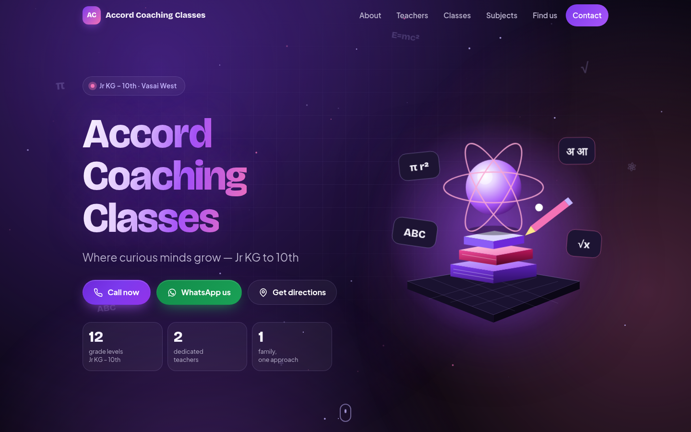
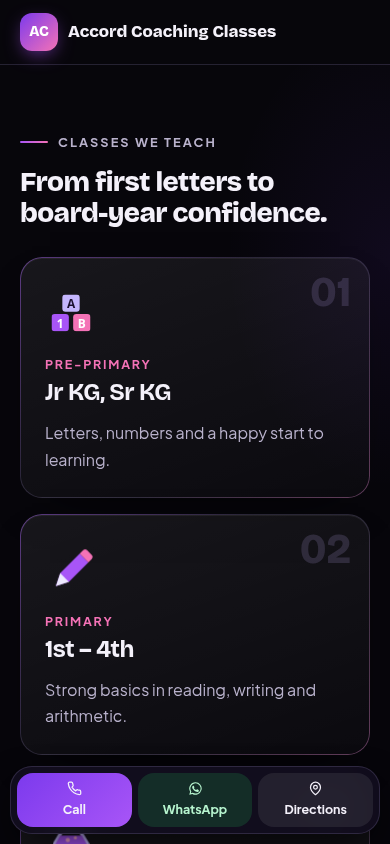
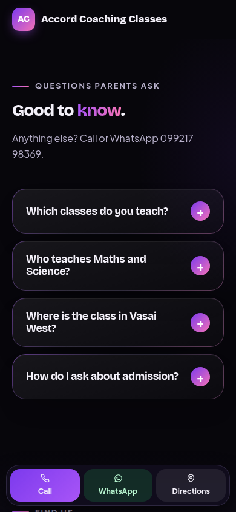

# Accord Coaching Classes, Vasai West

The website of **Accord Coaching Classes**, a family-run tuition and coaching class in Bangli, Vasai West (Vasai-Virar, Maharashtra) for **Jr KG to 10th standard**. Harshit Patel teaches Maths and Science; his mother teaches languages and all other subjects.

**Live site:** https://harshipatel2006.github.io/accord-coaching-classes-vasai/
**Call / WhatsApp:** 099217 98369

| Phone | Classes | FAQ |
|---|---|---|
|  |  |  |

## What it is

A fast, single-page, dark black-and-purple site for a local coaching class:

- Hand-drawn isometric SVG hero scene, aurora glow, starfield canvas, subject marquee, glow cards with 3D tilt. All motion uses `transform`/`opacity` and turns off under `prefers-reduced-motion`.
- Mobile-first, with a sticky Call / WhatsApp / Directions bar on phones.
- Local SEO: keyword-focused title and description, canonical URL, Open Graph and Twitter cards, `EducationalOrganization` + `LocalBusiness` + `WebSite` + `FAQPage` JSON-LD, geo meta tags, `sitemap.xml`, `robots.txt` and a `404.html`.
- No frameworks, no trackers, no external fonts: plain HTML, CSS and ~200 lines of JavaScript. Lighthouse 100 for Accessibility, Best Practices and SEO.
- A polished student/teacher portal preview at `portal.html`, with a Std 9 Maharashtra Board portion tracker, timed PDF tests, answer submission, marks and downloadable progress reports.

## Portal status: local demo

The portal is deliberately labelled **Demo mode**. GitHub Pages cannot provide private authentication or storage, and no authenticated backend CLI was available while this version was built. Demo data and PDF files are stored in the current browser only. Do not use it for real student records.

Demo sign-ins:

- Student: `danny_parmar` / `parmar1234`
- Teacher: `harshit_patel` / `patel040506`

For production, create a Supabase project and replace the browser storage layer with:

1. Supabase Auth accounts created by a server-only seed script (never embed passwords or the service-role key in client code).
2. `profiles`, `portions`, `tests`, and `submissions` tables with row-level security: teachers can manage all class records; students can read/write only their profile, portions and submissions.
3. Private `test-papers` and `answer-pdfs` buckets, PDF MIME validation, a 10 MB server-side limit, and short-lived signed download URLs.
4. A database policy or Edge Function that returns test papers only inside `available_from` / `available_until`; answers remain private after expiry.
5. Environment-provided public project URL and anonymous key, a 30-minute session policy, teacher-only account creation, and an audit log for marks changes.

The checked-in demo uses SHA-256 comparisons only to avoid plainly embedding passwords in JavaScript. That is not secure authentication because all client code is public.

## Tech

| Part | File |
|---|---|
| Page template | `src/index.html` (built to `index.html`) |
| Business facts (single source of truth) | `site.json` — every fact is sourced in `facts.md` |
| Build (template, JSON-LD, sitemap, robots, 404) | `node tools/build.mjs` |
| Styles / scripts | `styles.css`, `main.js` |
| OG image and icons | `tools/render-images.sh` (headless Chrome) |
| Publish to GitHub Pages | `tools/deploy.sh` |

## Reuse it for your own class or shop

1. Fork the repo and edit `site.json` (name, locality, phone, address, map pin, hours, `siteUrl`).
2. Edit the copy in `src/index.html` and the FAQ answers in `tools/build.mjs` (they must match the page).
3. `node tools/build.mjs`, then `tools/render-images.sh` to redraw the OG image and icons.
4. Serve the folder (`python3 -m http.server`) to check it, then publish with GitHub Pages.

Only put real, verifiable facts in `site.json`: no invented reviews, results or numbers.

## Licence

Code: [MIT](LICENSE). The business name, facts and contact details belong to Accord Coaching Classes. Fonts (Bricolage Grotesque, Plus Jakarta Sans) are under the SIL Open Font Licence.
